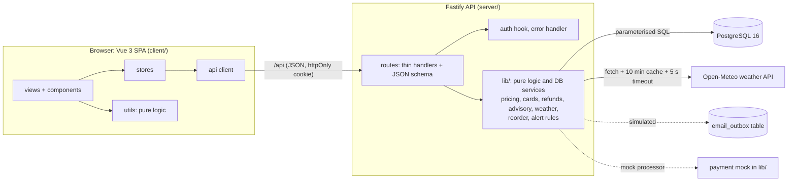
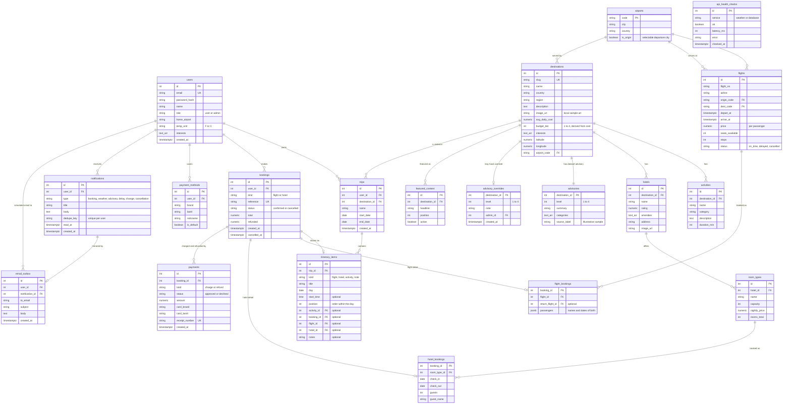
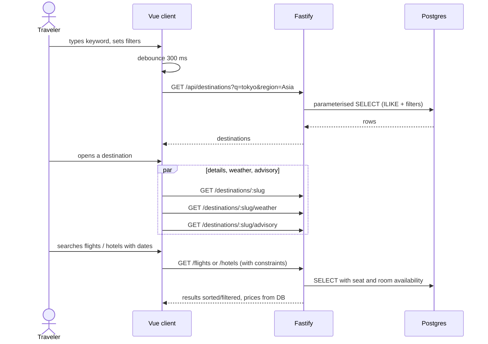
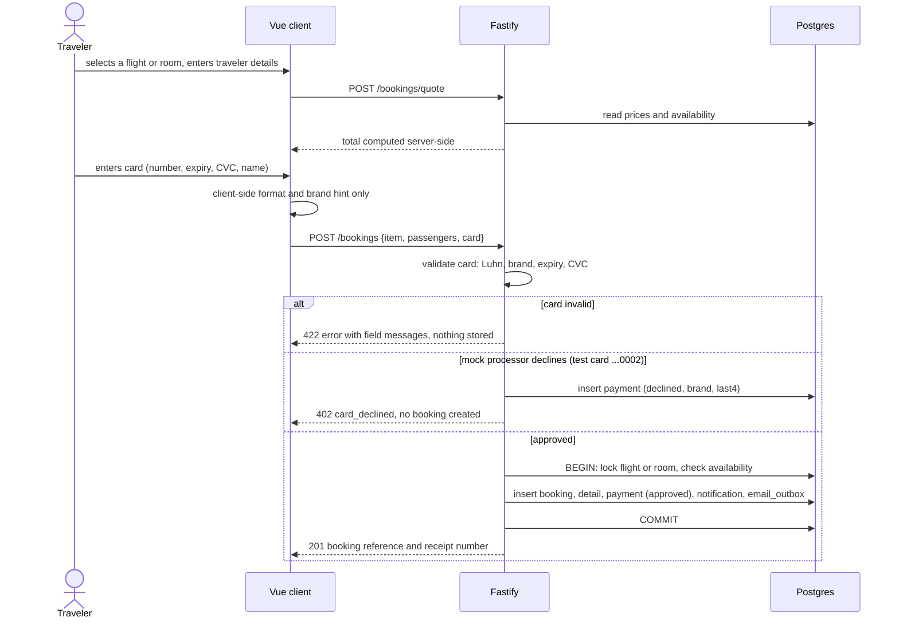
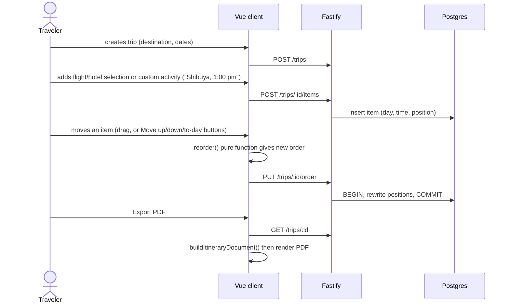
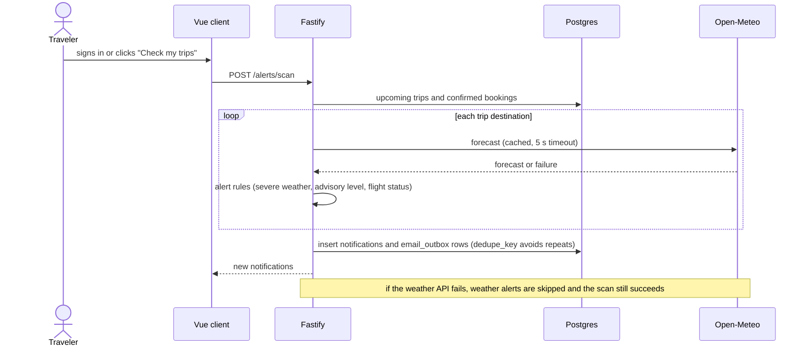

# Wayfarer Architecture

> **Build status (2026-10-22):** only the Sprint 1 MVP is built. Booking, payments, notifications, profile editing, admin and the related tables, routes and flows described below are the *target design* for later sprints and are **not in the code** right now. See the re-scoping log in [backlog.md](backlog.md).

Requirements: [project-docs.txt](project-docs.txt). Stories: [backlog.md](backlog.md). Stack is fixed by `CLAUDE.md`: Vue 3 + Vue Router + TypeScript (Vite), Fastify + TypeScript, PostgreSQL 16 with plain SQL (`pg` / `@fastify/postgres`), Vitest.

## 1. Components



Design rules that follow from the brief:

- **Routes are thin; logic lives in `server/src/lib/`.** Business rules are pure functions or take a small `Queryable` interface (`query(text, params)`), so unit tests pass a mocked client (cancel/refund) and integration tests pass the real pool. This is also what makes the 90% coverage target on `lib/` realistic.
- **Same idea on the client:** `client/src/utils/` holds pure logic (reorder, debounce, date maths, formatting, card brand hints) and `client/src/api/` the typed fetch wrapper; both have a 90% line threshold in `vite.config.ts`.
- **The server owns money.** Totals are computed in `lib/pricing.ts` from DB prices; request schemas have no amount field.
- **External calls degrade, never crash.** Weather failures return an "unavailable" payload with HTTP 200 so the page keeps working.

## 2. Repository layout

```
client/   Vue SPA          src/{api,components,router,stores,utils,views}
server/   Fastify API      src/{routes,lib,plugins}, scripts/db-init.ts, test/{unit,integration}
db/       schema.sql, seed.sql
docs/     backlog, sprint plan, risks, architecture, test strategy, sprint reviews
.github/workflows/ci.yml
docker-compose.yml        Postgres 16
```

API response types are declared in `server/src` and mirrored in `client/src/api/types.ts` (the layout is fixed by `CLAUDE.md`, so there is no shared package). Integration tests assert response shapes so a drift between the two fails the build.

## 3. Conventions

- **Money:** `numeric(10,2)` in Postgres; a `pg` type parser returns `number`; arithmetic is done in integer cents in `lib/money.ts` and converted back at the edge. Currency is USD only.
- **Dates:** `date` columns are parsed to `'YYYY-MM-DD'` strings (no `Date` objects, so no timezone shifts); `timestamptz` for instants (flight times, created_at).
- **Auth:** scrypt password hashes (Node `crypto`); session in an httpOnly, SameSite=Lax cookie holding a signed JWT; roles `user` and `admin`. Every user-owned query filters on `user_id`; other users' rows return 404.
- **Errors:** one error shape, `{ "error": { "code": "...", "message": "..." } }`; validation by Fastify JSON schema.
- **Sample data:** every flight, hotel, price and advisory view carries a "Sample data" label (advisories: "Illustrative, not official guidance").

## 4. Data model



Notes:

- `text_arr` in the diagram means a Postgres `text[]` column.
- **Card data:** there are no PAN, CVC or expiry columns anywhere; `payments` and `payment_methods` hold brand and last4 only (hard rule).
- **Effective advisory** = override if present, else dataset row; the dataset row is never modified, so removing an override restores the original.
- **Availability:** flights decrement `seats_available` on booking and restore it on cancel; room availability is `rooms_total` minus overlapping confirmed hotel bookings for the requested dates.
- **Itinerary order:** `(trip_id, day, position)`; reorder rewrites positions for the affected days in one transaction.
- `api_health_checks` is append-only; the admin page shows the latest row per service.
- The weather cache is in server memory (10 minutes, per destination); it is not persisted.

## 5. API surface

All paths are under `/api`. Auth: P = public, U = signed-in user, A = admin.

| Method and path | Auth | Story |
| --- | --- | --- |
| GET `/health` | P | TECH-01 |
| GET `/destinations?q=&region=&budget=&interest=` | P | SCRUM-11, 12 |
| GET `/destinations/filters` (regions, interests, tiers) | P | SCRUM-12 |
| GET `/destinations/:slug` (details, activities, images) | P | SCRUM-13 |
| GET `/destinations/:slug/weather` | P | SCRUM-14 |
| GET `/destinations/:slug/advisory` (effective advisory) | P | SCRUM-15 |
| GET `/advisories?q=&level=&region=&category=` | P | SCRUM-39 |
| GET `/featured` | P | SCRUM-42 |
| GET `/flights?origin=&destination=&depart=&return=&maxPrice=&sort=` | P | SCRUM-21 |
| GET `/hotels?destination=&checkIn=&checkOut=&guests=&minPrice=&maxPrice=&minRating=&amenity=` | P | SCRUM-23 |
| GET `/hotels/:id` (room types with availability and total) | P | SCRUM-24 |
| POST `/auth/register`, `/auth/login`, `/auth/logout` | P | SCRUM-34 |
| GET `/me`, PATCH `/me` (profile and preferences) | U | SCRUM-34 |
| GET, POST `/me/payment-methods`; PATCH, DELETE `/me/payment-methods/:id` | U | SCRUM-43 |
| POST `/bookings/quote` (server-computed price) | U | SCRUM-22, 24 |
| POST `/bookings` (create, pay, confirm) | U | SCRUM-22, 24, 25, 27 |
| GET `/bookings?sort=&status=` | U | SCRUM-26 |
| GET `/bookings/:id` (detail and receipt) | U | SCRUM-25, 26 |
| PATCH `/bookings/:id` (modify) | U | SCRUM-26 |
| POST `/bookings/:id/cancel` | U | SCRUM-37 |
| GET, POST `/trips`; GET, PATCH, DELETE `/trips/:id` | U | SCRUM-31 |
| GET `/trips?scope=past` | U | SCRUM-35 |
| POST `/trips/:id/items`; PATCH, DELETE `/trips/:id/items/:itemId` | U | SCRUM-31, 32 |
| PUT `/trips/:id/order` (reorder within and across days) | U | SCRUM-36 |
| GET `/notifications`; POST `/notifications/:id/read`, `/notifications/read-all` | U | SCRUM-27, 33 |
| POST `/alerts/scan` | U | SCRUM-33 |
| GET `/admin/api-status`; POST `/admin/api-status/check` | A | SCRUM-40 |
| PUT, DELETE `/admin/advisories/:destinationId/override` | A | SCRUM-41 |
| GET, POST `/admin/featured`; PATCH, DELETE `/admin/featured/:id` | A | SCRUM-42 |
| PATCH `/admin/flights/:id/status` (simulate delay or cancellation) | A | SCRUM-33 |

PDF export (SCRUM-38) has no endpoint: the client renders it from `GET /trips/:id`.

## 6. Main flows

### 6.1 Search (destinations, flights, hotels)



### 6.2 Book and pay



The card number and CVC exist only in the request body and are neither persisted nor logged (Fastify redaction on those fields).

### 6.3 Itinerary



### 6.4 Alerts



## 7. Key rules (kept in one place so they are easy to review)

| Rule | Value | Lives in |
| --- | --- | --- |
| Flight total | fare x passengers, plus 7.5% taxes and fees | `lib/pricing.ts` |
| Hotel total | nightly rate x nights x rooms, plus 12% tax | `lib/pricing.ts` |
| Nights | check-out minus check-in; a stay must be 1 to 30 nights | `lib/dates.ts`, `lib/hotels.ts` |
| Refund | 100% at 7 or more days before departure/check-in; 50% from 2 to under 7 days; 0% under 2 days (assumption G-12) | `lib/refunds.ts` |
| Card brands | Visa 4; Mastercard 51-55 and 2221-2720; Amex 34, 37; Discover 6011, 65, 644-649 | `lib/cards.ts` |
| Mock decline | card `4000 0000 0000 0002` | `lib/payments.ts` |
| Weather cache | 10 minutes per destination; 5 s upstream timeout | `lib/weather.ts` |
| Advisory levels | 1 Normal precautions, 2 Increased caution, 3 Reconsider travel, 4 Do not travel (illustrative wording, not an official scale) | `lib/advisory.ts` |
| Severe weather | WMO codes for thunderstorm, heavy rain, heavy snow or freezing rain, or wind above 60 km/h | `lib/alerts.ts` |

All values are my assumptions and are listed in [backlog.md](backlog.md) section 8 where they need approval.

## 8. Test architecture

- **Unit tests:** `server/test/unit` and colocated `client/src/**/*.test.ts`. No DB, no network: `fetch` and timers are faked, and DB access goes through a mocked `Queryable`.
- **Integration tests:** `server/test/integration` run Fastify via `inject()` against the real Postgres `wayfarer_test` database. Files run serially, each test creates its own data (unique emails) and asserts tolerantly because the database accumulates rows (risk R-05).
- **Component tests:** Vue Test Utils with jsdom for the advisory banner, weather panel states, checkout error/busy states and search debounce.
- **Coverage gate:** 90% lines on server `lib/` and client `utils/` and `api/` (enforced by Vitest thresholds in CI); overall coverage is reported per sprint. Details go in `docs/test-strategy.md` when the first story lands.
- **Manual:** browser smoke test in Phase 3 (search, checkout with a declined card, drag-and-drop, PDF, cancellation, advisories, admin).

## 9. Dependencies and why

| Package | Where | Reason |
| --- | --- | --- |
| fastify, @fastify/postgres, pg | server | Fixed stack. |
| @fastify/cookie, @fastify/jwt | server, **added with SCRUM-34** | httpOnly cookie sessions; avoids hand-rolling token signing. |
| vue, vue-router | client | Fixed stack. |
| pinia | client, **added with SCRUM-34** | Standard Vue store; the brief asks for tested stores. |
| a client-side PDF library (jsPDF, to be confirmed) | client, **added with SCRUM-38** | Avoids server-side rendering; the document model stays library-independent. |
| vite, @vitejs/plugin-vue, vue-tsc | client dev | Build and type-check `.vue` files. |
| vitest, @vitest/coverage-v8, @vue/test-utils, jsdom | dev | Fixed test stack. |
| tsx | server dev | Runs TypeScript for `dev` and `db:init`. |
| eslint, typescript-eslint, eslint-plugin-vue, eslint-config-prettier, prettier | root dev | Lint and format. |
| concurrently | root dev | `npm run dev` starts client and server together. |
| typescript pinned to 6.0.x | dev | typescript-eslint does not yet support TypeScript 7. |

Native HTML5 drag and drop is used for reordering (no library). Dependencies added later will be called out in the story's PR description.

## 10. Decisions and deviations

| Decision | Why |
| --- | --- |
| Postgres seed SQL instead of local JSON (ConOps 3.2.1) | `CLAUDE.md` fixes the stack; gap G-05. |
| No background scheduler for alerts | Deterministic and testable; gap G-08. |
| Simulated email via table | No mail provider; gap G-07. |
| Server build uses `module: NodeNext` (imports end in `.js`) | `tsc` output runs on plain Node with no bundler. |
| API types mirrored, not shared | Layout fixed by `CLAUDE.md`; contract tests guard drift. |
